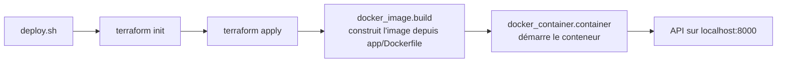

# Déployer un conteneur Docker avec Terraform

Infrastructure as Code en miniature : une petite API FastAPI est empaquetée dans une image Docker, puis déployée sur la machine locale par **Terraform**. Deux scripts bash permettent de déployer et de détruire toute l'infrastructure en une commande.

Ce dépôt est le résultat d'un TP de DevOps sur le cloud et l'IaC. Le principe est celui de Terraform sur un vrai cloud (Azure, AWS...), mais le provider utilisé ici est **Docker**, ce qui permet de tout exécuter sans compte cloud.

## Fonctionnement



Terraform décrit l'état voulu (une image construite, un conteneur démarré, un port exposé) et calcule lui-même ce qu'il faut créer. Le conteneur dépend de l'image par une référence (`docker_image.build.image_id`) : Terraform en déduit l'ordre de création sans qu'on ait à le préciser.

## Prérequis

- [Docker](https://docs.docker.com/get-docker/), accessible sans `sudo` (utilisateur dans le groupe `docker`)
- [Terraform](https://developer.hashicorp.com/terraform/install)
- Le port `8000` libre sur la machine

## Utilisation

```bash
git clone https://github.com/lemeemoret/tp-terraform-docker.git
cd tp-terraform-docker

./scripts/deploy.sh      # construit l'image et démarre le conteneur
curl localhost:8000      # interroge l'API
./scripts/destroy.sh     # supprime le conteneur et l'image
```

Réponse attendue de l'API :

```json
{"message":"Hello depuis un conteneur déployé par Terraform"}
```

La documentation interactive générée par FastAPI est disponible sur http://localhost:8000/docs.

Relancer `./scripts/deploy.sh` une deuxième fois ne change rien : Terraform détecte que l'infrastructure correspond déjà à la configuration (`No changes`). C'est la propriété d'idempotence du déclaratif.

Si les scripts ne sont pas exécutables : `chmod +x scripts/*.sh`.

## Structure du dépôt

```
.
├── app/
│   ├── main.py              # API FastAPI (une route GET /)
│   ├── requirements.txt     # fastapi, uvicorn
│   └── Dockerfile           # image python:3.12-slim
├── infra/
│   ├── main.tf              # description Terraform de l'infrastructure
│   └── .terraform.lock.hcl  # verrouillage de la version du provider
├── scripts/
│   ├── deploy.sh            # terraform init + apply
│   └── destroy.sh           # terraform destroy
└── .gitignore               # exclut le state et le dossier .terraform
```

## Ce que décrit `infra/main.tf`

| Élément | Rôle |
|---|---|
| `required_providers` | Fixe le provider `kreuzwerker/docker` en version `~> 3.0` (toute version 3.x), pour qu'une future version majeure ne casse pas le déploiement. |
| `provider "docker"` | Pointe vers le démon Docker local par sa socket Unix (`unix:///var/run/docker.sock`). |
| `docker_image.build` | Construit l'image `tp-terraform-app:latest` à partir du `Dockerfile` du dossier `app/`. |
| `docker_container.container` | Crée et démarre le conteneur à partir de cette image, avec le port `8000` du conteneur exposé sur le port `8000` de la machine. |

## Les scripts

Les deux scripts utilisent `set -euo pipefail` (arrêt à la première erreur) et se placent eux-mêmes dans `infra/` avec `cd "$(dirname "$0")/../infra"`, ce qui permet de les lancer depuis n'importe quel dossier.

- `deploy.sh` : `terraform init` télécharge le provider, puis `terraform apply -auto-approve` applique le plan sans demander de confirmation.
- `destroy.sh` : `terraform destroy -auto-approve` supprime les ressources du state, le conteneur d'abord puis l'image.

`-auto-approve` convient pour un TP local. Sur une infrastructure réelle, on lit le plan (`terraform plan`) avant d'appliquer, surtout pour une destruction.

## Gestion du state

Le fichier `terraform.tfstate`, où Terraform enregistre ce qu'il a créé, **n'est pas versionné** : il peut contenir des informations sensibles. Il est exclu par le `.gitignore`, comme le dossier `.terraform/` (provider téléchargé, regénérable). En revanche, `.terraform.lock.hcl` est commité pour que toute personne qui clone le dépôt utilise exactement la même version du provider.

Dans un contexte d'équipe, le state serait stocké à distance (un *backend*, par exemple Azure Storage) pour être partagé et verrouillé.

## Pistes d'amélioration

- Rendre le port configurable avec une variable Terraform (`variables.tf`).
- Reconstruire automatiquement l'image quand le code change, avec l'argument `triggers` de `docker_image`.
- Brancher un pipeline CI/CD (GitHub Actions) qui lance `terraform validate` et `terraform plan` à chaque pull request.

## Technologies

- [Terraform](https://www.terraform.io) et le provider [kreuzwerker/docker](https://registry.terraform.io/providers/kreuzwerker/docker/latest)
- [Docker](https://www.docker.com)
- [FastAPI](https://fastapi.tiangolo.com) et [Uvicorn](https://www.uvicorn.org)
- Bash
